**Repository:** https://github.com/Ilyas-aitkhozha/smart-campus-code-vs-lowcode  
**Code-based live demo (baseline):** https://smart-campus-11-1q5d.bolt.host  
**Low-code:** Appsmith Cloud app *smart campus-lowcode* (editor preview; not deployed, see Limitations)

## Summary
The same feature, "is room R-101 free for this start time and duration?", was built twice: in code (the existing Bolt.new JavaScript project) and in Appsmith (low-code). Both were run against one shared contract and eight identical tests. Both passed **8/8**. The code-based version took about 6 minutes, AI-assisted, because it reused the existing engine. The Appsmith version took about 30 minutes by hand and still needed a JavaScript object for the rules. **Recommendation: code-based**, for testability, Git versioning, portability and zero cost.

## Task 01 — Frozen baseline

| Item | Value |
|---|---|
| Source | Bolt.new export `project-bolt-sb1-tt4jygux.zip` (Smart Campus checker, Practice #09–#11 line) |
| Package | `smart-campus-practice09` v1.0.0 |
| Toolchain | Node v24.13.1, npm 11.8.0, Vite 6.4.5, Vitest 3.2.7 |
| Live demo (baseline) | https://smart-campus-11-1q5d.bolt.host |
| Fixed "now" | 2026-10-28 09:00 |
| Room | R-101, `blocked: false` by default |
| Fictional bookings | B1 10:00–11:00, B2 14:00–15:00 (R-101) |
| Baseline UI inputs | start time + **end time** + blocked checkbox |
| Existing checks | `npm test` → **58 passed (58)**, 4 test files. See `evidence/01-baseline-tests.txt` |
| Baseline screenshot | `screenshots/code-based/00-baseline-live-demo.jpg` |

## Expected behaviour (baseline rule `checkAvailability`)
- `start >= end` → `START_NOT_BEFORE_END`; `start < now` → `IN_THE_PAST`
- more than 120 minutes → `TOO_LONG` (exactly 120 is allowed)
- blocked room → `ROOM_BLOCKED`
- overlap with a booking of the same room → `OVERLAP`. Touching intervals are allowed (strict `<` / `>`).
- the bookings array is never mutated (a copy is sorted)

## Freeze rule
`src/availability.js` and `src/fixtures.js` were **not modified** in Practice #13, so the booking rules were not tuned to favour either approach.
The low-code app uses the same fixture values (copied by hand, see `low-code/appsmith/`).

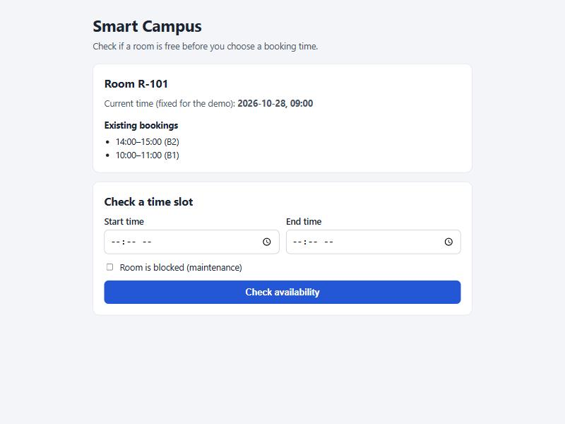{width=15cm}

## Task 02 — Shared requirement / acceptance-criteria sheet

This one sheet applies to **both** solutions (code-based and Appsmith low-code).

## User story
As a student, I want to choose a future start time and a duration for campus room R-101,
so that I immediately see whether the room is Available or Unavailable and why.

## Acceptance criteria
| ID | Criterion |
|---|---|
| AC1 | Start time must be in the future (strictly after the fixed "now", 2026-10-28 09:00). |
| AC2 | Duration must be greater than zero and at most 120 minutes (whole minutes). |
| AC3 | A slot that overlaps an existing booking is Unavailable. A slot that only touches a booking (e.g. 11:00 after 10:00–11:00) is allowed. |
| AC4 | A blocked room is Unavailable. |
| AC5 | A clear decision is displayed, and existing bookings are never changed. |
| AC6 | Invalid input gets understandable feedback (no crash, no silent "Available"). |

## Inputs
| Input | Type | Notes |
|---|---|---|
| `startTime` | `HH:MM` on 2026-10-28 | 00:00–23:59 |
| `durationMinutes` | integer | 1–120 is valid |
| `blocked` | boolean | room status (maintenance) |
| `bookings` | fixed fictional list | B1 R-101 10:00–11:00, B2 R-101 14:00–15:00 |
| `now` | fixed | 2026-10-28 09:00 |

## Outputs
| Output | Type | Example |
|---|---|---|
| `available` | boolean | `false` |
| `reasonCode` | string | `OVERLAP` |
| `message` | visible text | `Unavailable: this time overlaps with an existing booking.` |

## Reason codes (evaluation order)
| # | reasonCode | Kind | Visible message |
|---|---|---|---|
| 1 | `INVALID_START_TIME` | validation | Enter a valid start time (HH:MM). |
| 2 | `INVALID_DURATION` | validation | Enter the duration as a whole number of minutes. |
| 3 | `DURATION_TOO_SHORT` | validation | Duration must be greater than 0 minutes. |
| 4 | `DURATION_TOO_LONG` | validation | Duration can be at most 120 minutes. |
| 5 | `IN_THE_PAST` | validation | This start time is not in the future. Choose a later start time. |
| 6 | `ROOM_BLOCKED` | decision | Unavailable: this room is blocked and cannot be booked right now. |
| 7 | `OVERLAP` | decision | Unavailable: this time overlaps with an existing booking. |
| 8 | `OK` | decision | Available: the room is free for this time slot. |

Overlap rule: `start < booking.end AND end > booking.start`, where `end = start + duration`.

## Common test inputs (prepared before implementation)
| Test | startTime | duration | blocked | Expected |
|---|---|---|---|---|
| T1 | 12:00 | 60 | no | Available, `OK` |
| T2 | 10:30 | 60 | no | Unavailable, `OVERLAP` (B1) |
| T3 | 12:00 | 60 | yes | Unavailable, `ROOM_BLOCKED` |
| T4 | 12:00 | 0 | no | validation error, `DURATION_TOO_SHORT` |
| T5 | 12:00 | 121 | no | validation error, `DURATION_TOO_LONG` |
| T6 | 08:00 | 30 | no | validation error, `IN_THE_PAST` |
| T7 | 11:00 | 60 | no | Available, `OK` (touches B1, no overlap) |
| T8 | after T1–T7 | — | — | bookings list still B1 10:00–11:00, B2 14:00–15:00 |

## Task 03 — Code-based solution

Folder: `code-based/` (Vite + vanilla JavaScript, reused from the Bolt.new project).

## Structure (validation → availability → display)
| Layer | File | Responsibility |
|---|---|---|
| Validation | `src/validation.js` | `validateSlotInput()`: HH:MM format, integer duration 1–120, start strictly after now |
| Availability | `src/availability.js` | `checkAvailability()`: **unchanged** rule from Practice #08 (blocked, overlap, no mutation) |
| Contract | `src/slotChecker.js` | `checkSlot()` → `{ available, reasonCode, message, kind }` |
| Messages | `src/messages.js` | one visible message per reason code |
| UI | `src/main.js`, `index.html`, `src/style.css` | reads inputs, calls `checkSlot`, renders with `textContent` |
| Tests | `tests/contract-t1-t8.test.js` | T1–T8 plus 7 boundary/invalid-input checks |

## Changes vs. baseline
- The UI input "End time" was replaced by "Duration (minutes)", as the Practice #13 contract requires.
- A new validation layer returns validation reason codes. Duration 0 now gives `DURATION_TOO_SHORT` instead of the indirect `START_NOT_BEFORE_END`.
- The result shows the message and `available=… · reason=…`, so the output contract is visible.
- Validation errors use a yellow banner, Unavailable a red one, Available a green one.
- The optional "Explain availability" mock from Practice #11 was kept. It appears only after a real decision, not after a validation error.

## Evidence
- `evidence/05-code-based-tests.txt`: `npm test` → **73 passed (73)**, 5 files (58 old + 15 new)
- `evidence/05-code-based-T1-T8-verbose.txt`: per-test list for T1–T8
- `evidence/03-code-based-build.txt`: `vite build` succeeded
- `screenshots/code-based/T1…T7-*.jpg`: running app, desktop
- `screenshots/code-based/mobile-375px.jpg`: 375 px width. Fields stack vertically and `scrollWidth == innerWidth == 375`, so there is no horizontal scroll.

## Run
```
cd code-based
npm ci
npm test
npm run dev
```

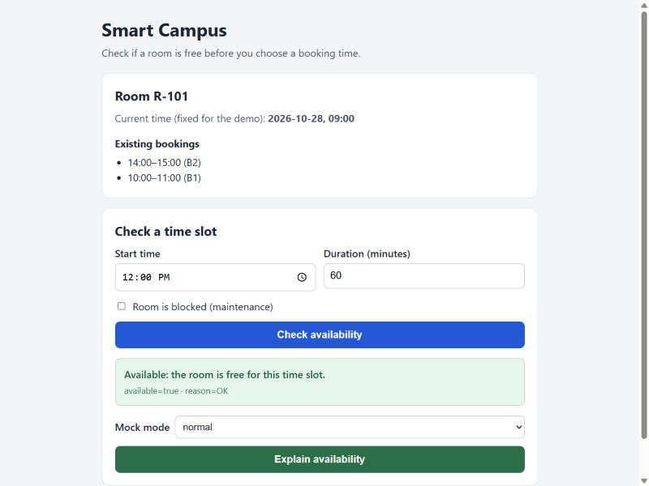{width=15cm}

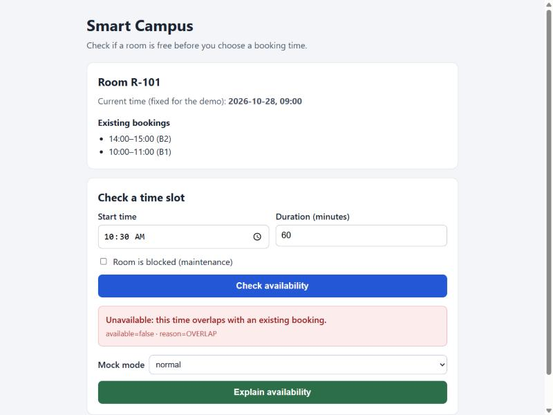{width=15cm}

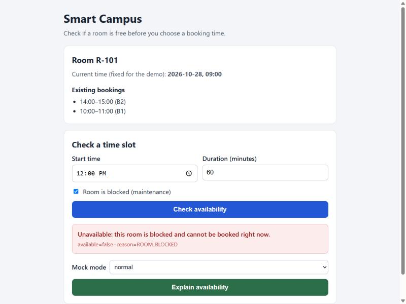{width=15cm}

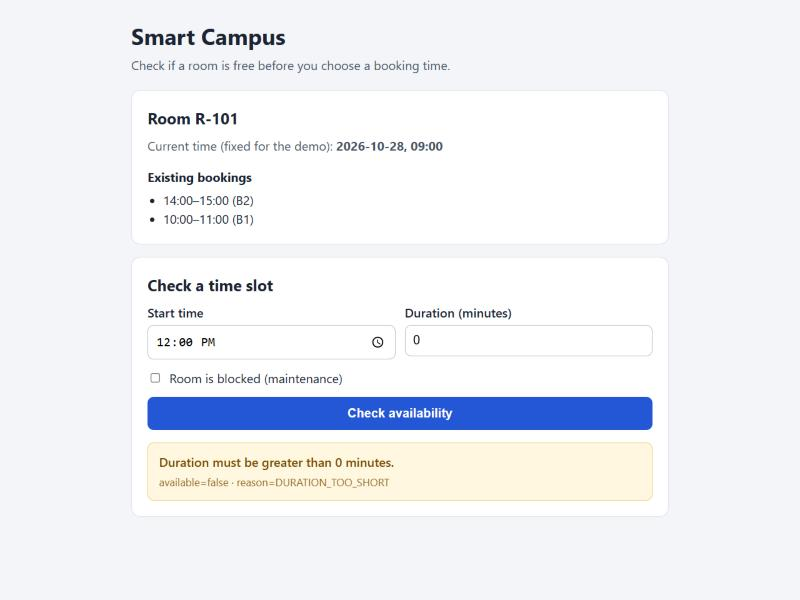{width=15cm}

{width=15cm}

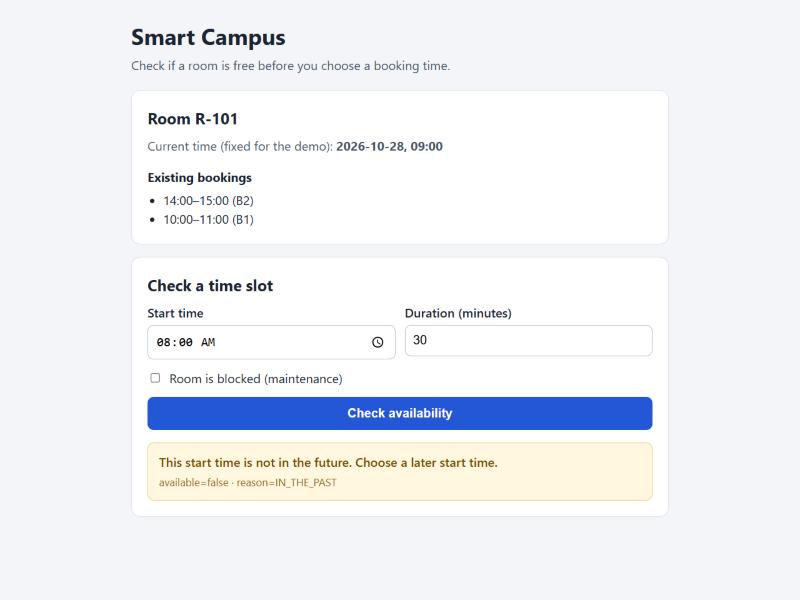{width=15cm}

{width=15cm}

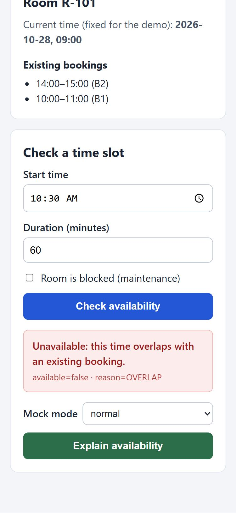{width=15cm}

## Task 04 — Low-code solution in Appsmith (build guide)

Platform: Appsmith Cloud, free plan (https://app.appsmith.com). No subscription and no datasource are needed.
Bookings are a constant list in a JS Object. The app does not use a database, login, connector or API key.

> ⏱ Measure time separately for **setup**, **implementation**, **debugging** and **testing** (Task 06).

### 1. Setup
1. Sign in to Appsmith Cloud and create a new workspace application named `Smart Campus — low-code`.
2. Open the app. You land on the empty canvas of `Page1`.

### 2. Widgets (drag from the left Widgets panel)
> Lesson learned while building: any `{{ … }}` binding must go into the field **after pressing the small `JS` toggle** next to the property name (e.g. Table data, onClick). Typing it into the dropdown search does nothing.
> The button was finally wired with onClick → JS → `{{SlotChecker.check()}}`, and the result text with `{{SlotChecker.result.message + "  (reason=" + SlotChecker.result.reasonCode + ")"}}` in a single Text widget.

| Widget | Name (rename it!) | Properties |
|---|---|---|
| Text | `txtTitle` | Text: `Smart Campus — Room R-101 (low-code)` |
| Text | `txtNow` | Text: `Current time (fixed for the demo): 2026-10-28, 09:00` |
| Table | `tblBookings` | Table data: `{{SlotChecker.bookings}}`. Turn off "Allow adding a row", inline editing and the "Download" button. |
| Input | `inpStart` | Data type: Text. Label: `Start time (HH:MM)`. Placeholder: `12:00` |
| Input | `inpDuration` | Data type: **Number**. Label: `Duration (minutes)`. Default value: `60` |
| Switch | `swBlocked` | Label: `Room is blocked (maintenance)`. Default: off |
| Button | `btnCheck` | Label: `Check availability`. onClick → Execute a JS function → `SlotChecker.check` |
| Text | `txtResult` | Text: `{{SlotChecker.result.message}}` |
| Text | `txtCode` | Text: `{{"available=" + SlotChecker.result.available + " · reason=" + SlotChecker.result.reasonCode}}` |

Optional, no code: `txtResult` → Style → Text color →
`{{SlotChecker.result.available ? "#17643a" : "#9b1c1c"}}`

**Leave Min/Max/Regex/Required unset on the inputs.** Otherwise Appsmith blocks the button before the check runs, and T4/T5 would show the widget's own tooltip instead of the shared message. Record in the report if you try that variant.

### 3. Logic (the only script)
1. Left panel → **JS** → `+` → New JS Object → rename it to `SlotChecker`.
2. Replace its content with `SlotChecker.jsobject.js` from this folder and save.
3. Click `btnCheck` once in preview to make sure the result text changes.

### 4. Responsive check
Switch the canvas to **Mobile** (the device icon at the top) and confirm the widgets stack and stay readable. Take a screenshot.

### 5. Tests T1–T8
Press **Preview** (top right). For each case, type the values, press the button and take a screenshot:

| Test | Start | Duration | Blocked | Expected text |
|---|---|---|---|---|
| T1 | 12:00 | 60 | off | Available … reason=OK |
| T2 | 10:30 | 60 | off | Unavailable: overlaps … reason=OVERLAP |
| T3 | 12:00 | 60 | **on** | Unavailable: blocked … reason=ROOM_BLOCKED |
| T4 | 12:00 | 0 | off | Duration must be greater than 0 … DURATION_TOO_SHORT |
| T5 | 12:00 | 121 | off | Duration can be at most 120 … DURATION_TOO_LONG |
| T6 | 08:00 | 30 | off | not in the future … IN_THE_PAST |
| T7 | 11:00 | 60 | off | Available … reason=OK |
| T8 | — | — | — | the table still shows B1 10:00–11:00 and B2 14:00–15:00 |

Also try these DAST-style inputs: `<b>x</b>` and `` as start time.
Expected result: "Enter a valid start time (HH:MM)", no bold text and no alert.

### 6. Publish, sharing and export
1. **Deploy** (top right).
2. Share → "Make application public" **on**, so the teacher can open the link. Do not invite anyone as an editor.
3. Copy the deployed URL into the report.
4. App menu (⋯ next to the app name on the home page) → **Export** → save the `.json` file as `low-code/appsmith/export/smart-campus-lowcode.json`.
   Before committing, check that it contains no tokens or e-mails. The AI assistant will check it too.

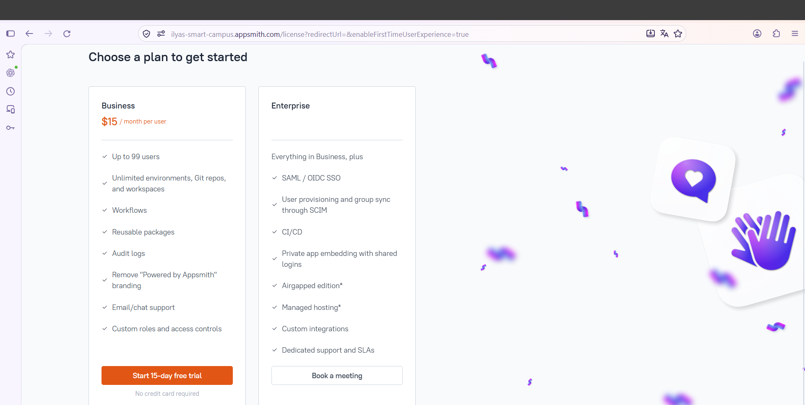{width=15cm}

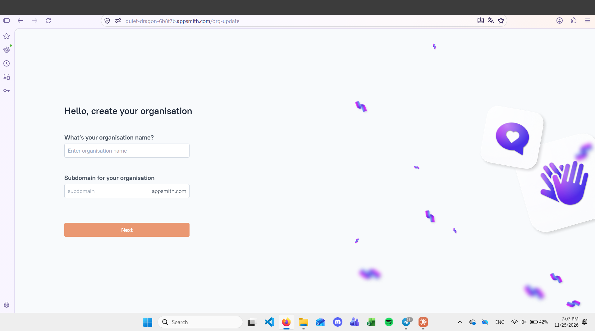{width=15cm}

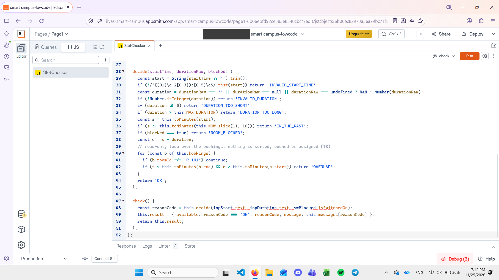{width=15cm}

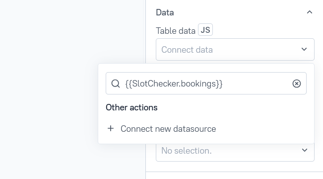{width=15cm}

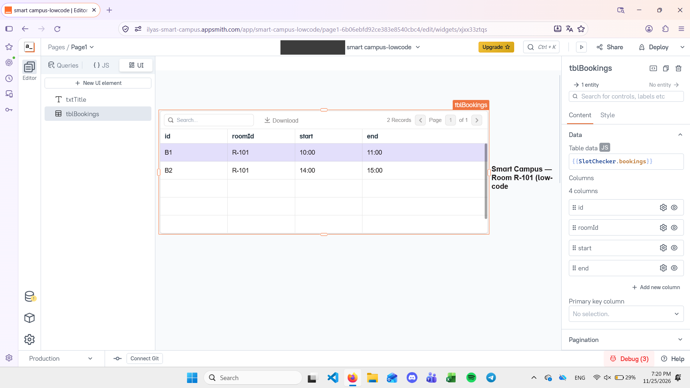{width=15cm}

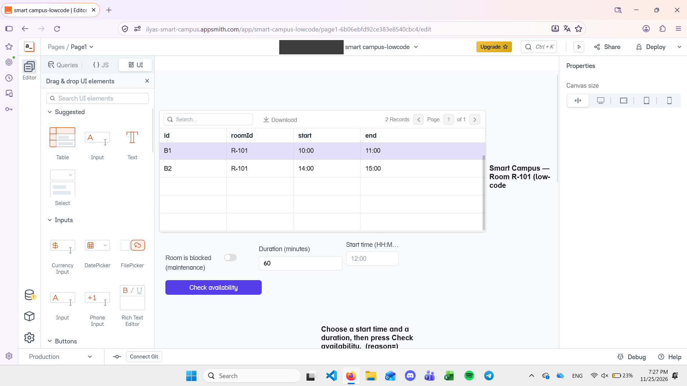{width=15cm}

## Task 05 — Identical tests T1–T8

Fixed now: 2026-10-28 09:00. Bookings: B1 10:00–11:00, B2 14:00–15:00.
- **Code-based:** Vitest (`evidence/05-code-based-T1-T8-verbose.txt`) **and** manual runs in the browser (`screenshots/code-based/`).
- **Low-code:** manual runs in the Appsmith editor preview on 2026-11-25, 19:29–19:31 (`screenshots/low-code/T*.png`; the clock is visible in each screenshot).

| Test | Input (start, duration, blocked) | Expected | Code-based observed | Low-code observed |
|---|---|---|---|---|
| T1 | 12:00, 60, no | Available / OK | ✅ Available, `OK` | ✅ "Available: the room is free…" `OK` |
| T2 | 10:30, 60, no | Unavailable / OVERLAP | ✅ Unavailable, `OVERLAP` | ✅ "Unavailable: this time overlaps…" `OVERLAP` |
| T3 | 12:00, 60, yes | Unavailable / ROOM_BLOCKED | ✅ Unavailable, `ROOM_BLOCKED` | ✅ "Unavailable: this room is blocked…" `ROOM_BLOCKED` |
| T4 | 12:00, 0, no | validation / DURATION_TOO_SHORT | ✅ `DURATION_TOO_SHORT` | ✅ "Duration must be greater than 0 minutes." |
| T5 | 12:00, 121, no | validation / DURATION_TOO_LONG | ✅ `DURATION_TOO_LONG` | ✅ "Duration can be at most 120 minutes." |
| T6 | 08:00, 30, no | validation / IN_THE_PAST | ✅ `IN_THE_PAST` | ✅ `IN_THE_PAST`. Run with **08:30** instead of 08:00, see note 1 |
| T7 | 11:00, 60, no | Available / OK (touching) | ✅ Available, `OK` | ✅ "Available…" `OK` |
| T8 | after T1–T7 | bookings unchanged | ✅ `toEqual(snapshot)` + UI list unchanged | ✅ the table shows B1 10:00–11:00 and B2 14:00–15:00 in every screenshot T1–T7 |
| **Total** | | | **8 / 8** | **8 / 8** |

## Extra runtime checks (DAST perspective)
| Check | Code-based | Low-code |
|---|---|---|
| HTML/script-like start time | `<script>alert(1)</script>` → `INVALID_START_TIME`, not echoed (automated test) | `<.b` → "Enter a valid start time (HH:MM)." `INVALID_START_TIME`, nothing rendered as HTML (`X1-html-like-input-1931.png`), see note 2 |
| Mobile width | ✅ 375 px, no horizontal scroll (`mobile-375px.jpg`) | ⚠️ **not checked**: no mobile screenshot was taken |

## Notes
1. **T6 input deviation (low-code).** The shared input was 08:00; 08:30 was typed. Both values lie before the fixed now (09:00) and hit the same rule branch (`s <= now`), so the result is comparable. Even so, the low-code T6 input did not match the sheet exactly.
2. **Partial XSS input (low-code).** The planned payload was `<b>x</b>`, but `<.b` was typed. It still shows that an HTML-like string is rejected by validation and never echoed. A full `` payload was **not** tried in Appsmith.
3. **Observation in both apps.** When the inputs are cleared, the previous result stays visible until the button is pressed again (`X0-stale-result-after-clearing-1931.png`). This is not a T1–T8 failure. It is a UX weakness and is listed in the limitations.
4. Low-code tests ran in the **editor preview**, not in a deployed app.

{width=15cm}

{width=15cm}

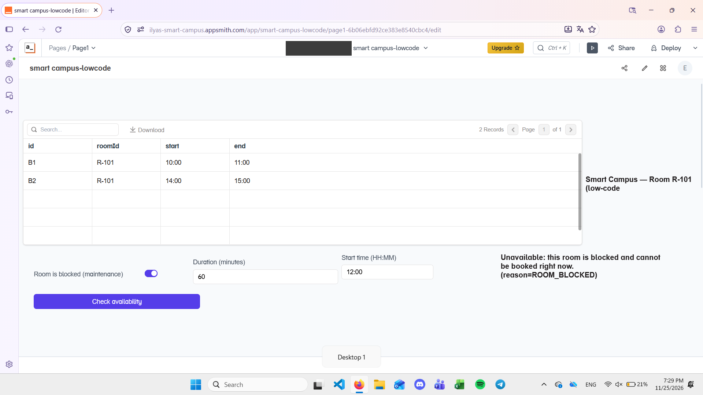{width=15cm}

{width=15cm}

{width=15cm}

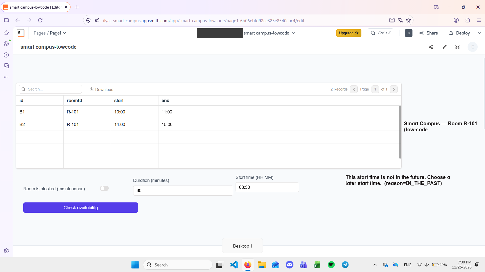{width=15cm}

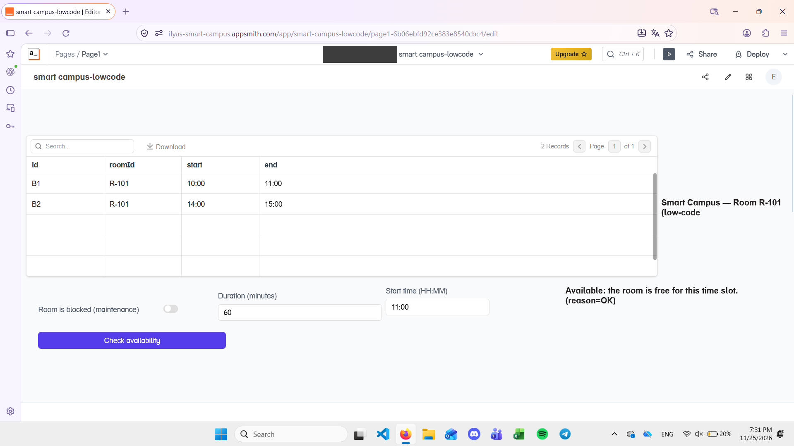{width=15cm}

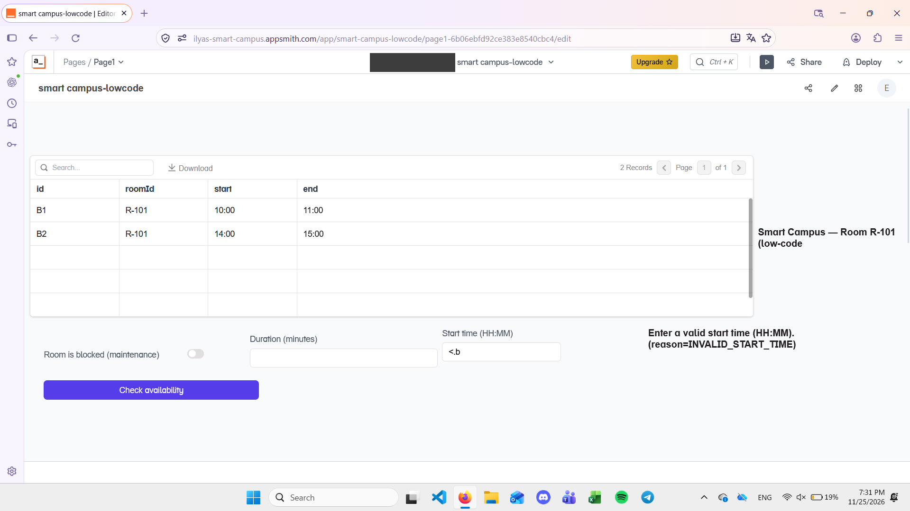{width=15cm}

## Task 06 — Engineering effort and comparison matrix

## Measured effort
Low-code times come from the system clock visible in full-screen screenshots (`screenshots/low-code/`).
Code-based times come from the Vitest "Start at" timestamps and the session log.

| Phase | Code-based | Low-code (Appsmith) | Evidence |
|---|---|---|---|
| Setup | ~1 min (unzip, `npm install`, baseline run 19:12:25 on 24.11) | **8 min** (19:01 → 19:09: sign-up, org creation loop, plan screen, editor open) | `00-setup-start-1901`, `02-org-loop-1907`, `03-editor-open-1909` |
| Implementation | ~2 min (new layers written, tests green 19:14:57) | **14 min** (19:09 → 19:27 minus debugging) | `04-jsobject-…-1912`, `07-widgets-done-1927` |
| Debugging | ~1 min (`npm ci` failed on a long Windows path; rerun in a short folder) | **≤ 4 min** (table data typed into the datasource search box instead of a JS binding; fixed by 19:20) | `05-debug-table-binding-mistake`, `06-table-bound-1920` |
| Testing | ~2 min (Vitest + 7 manual browser runs + mobile) | **~3 min** (19:29 → 19:31, 7 manual runs + 1 extra) | `T1…T7`, `X1` |
| **Total** | **~6 min** | **~30 min** (19:01 → 19:31) | |

**Read these numbers with care.** The code-based track reused an existing rule engine and tests, and an AI assistant wrote the new code.
The low-code track was built by hand in a new tool, with a written guide and a script that had been pre-checked against the same rules.
So the difference measures "reuse existing code + AI" vs. "learn a new platform", not code vs. low-code in general.

## Comparison matrix
| Criterion | Code-based | Low-code (Appsmith) |
|---|---|---|
| Functional tests | **8 / 8** (automated + manual) | **8 / 8** (manual only; T6 typed 08:30 instead of 08:00) |
| Build and repair time | **~6 min** | **~30 min** |
| Unresolved defects | 0 functional; stale result after clearing inputs (UX) | 0 functional; stale result after clearing inputs (UX); title missing `)` (cosmetic) |
| Customization | Full control of UI, messages, colours and breakpoints; any rule can be expressed and unit-tested | Fast visual layout, but non-trivial logic (overlap, validation order) still needed a JS Object. Widget-level validation shows its own tooltip, so it was not used, to keep one shared message set |
| Security controls | Validation in code, `textContent` only, 15 automated invalid-input tests, `npm audit` (SCA) | Same validation in a JS Object; platform renders text; table **Download** button left enabled; platform runtime not auditable by us |
| Versioning / portability | Plain files in Git, line-level diffs, runs anywhere with Node; `vite build` gives static files | App lives on Appsmith Cloud; "Connect Git" exists in the editor but was **not** used; app JSON export **not** done; logic is copied in `low-code/appsmith/SlotChecker.jsobject.js` |
| Ongoing cost | Free (static hosting / Bolt publish) | Cloud sign-up showed only paid plans (Business $15/user/month, Enterprise). Used a **15-day free trial, no card**. The app may stop working after the trial |

## Review, export and version control
| | Code-based | Low-code |
|---|---|---|
| Review | Line-by-line Git diff; tests run before acceptance | Visual inspection of each widget; no diff of widget changes was used |
| Export | Source files + `npm run build` | Platform JSON export (not done); the script file is kept in Git by hand |
| Version control | Git history in this repository | Not connected (Git connect available but not set up) |

## Measured vs. impressions
- **Measured:** test counts, timestamps from the clock in screenshots, audit output, the plan/paywall screen.
- **Impressions (author):** the Appsmith canvas was quick for layout once widgets were named, but the property panel hides where bindings go: the table data mistake. Code was easier to reason about for the overlap and validation order.

## Recommendation
For this feature, choose **code-based** as the primary solution. It is 8/8 with automated regression tests, it is versioned in Git with real diffs, it costs nothing, and it is portable.
Appsmith also reached 8/8, but only by placing the core rules in a JavaScript object anyway, so low-code saved layout work, not logic work. It also adds a trial-based cost risk and weaker version control unless Git sync is set up.
Low-code is reasonable for a quick internal prototype or admin screen, provided Git sync is connected and plan costs are approved.

## Task 07 — Security review (Lecture #12)

Scope: only our own two apps. No third-party service was scanned. All runtime checks were safe manual inputs.

| # | Check | Code-based | Low-code (Appsmith) |
|---|---|---|---|
| 1 | **Input validation (SQL/command injection)** | No database or queries. A strict regex `^([01]\d\|2[0-3]):[0-5]\d$` and an integer check 1–120 run before use | No datasource or queries. The same regex and integer check run in the JS Object `SlotChecker` |
| 2 | **Output handling (XSS)** | Results rendered with `textContent`, never `innerHTML`. Messages come from a fixed map and never echo input. `<script>alert(1)</script>` → `INVALID_START_TIME` (automated test) | Messages come from a fixed map and never echo input. `<.b` → `INVALID_START_TIME`, nothing rendered as HTML. A full `` payload was not tried |
| 3 | **Permissions / public sharing** | Static, read-only site; no admin or edit surface | Editor access only for the owner account; no other users invited. The app was **not** made public and not deployed |
| 4 | **Secrets** | `grep` for key/token/secret/password in `code-based/src`, `index.html`, `package.json`: nothing found. The explain feature is a mock with no API key | No API keys, connectors or datasources were created, so no secrets are stored in the app |
| 5 | **Connectors / data sources** | None | None. Bookings are a constant list in the JS Object |
| 6 | **Personal data** | None; fictional room and bookings only | None in the app. Appsmith names the workspace after the account e-mail, and screenshots also showed personal browser tabs. Both areas were blacked out in the published screenshots (sensitive-data exposure, Lecture #12) |
| 7 | **Data exposure** | Bookings are visible by design (fictional) | The table **Download** button is enabled, so any viewer could export the table. Harmless with fictional data; it should be turned off for real data |
| 8 | **SCA (dependencies)** | `npm audit`: 3 findings (1 moderate, 2 critical) in **dev-only** `vitest@3.2.7` → `@vitest/mocker`, `tinypool`. They are not in the shipped `dist/` bundle. The fix is an upgrade to vitest 5 (breaking change), recorded as an action. See `evidence/07-npm-audit.txt` | Platform-managed: Appsmith patches its runtime and widgets. We cannot see, audit or pin these components. The responsibility moves to the vendor; we only control the app config and the JS Object |
| 9 | **SAST (code review)** | Manual review of `validation.js`, `slotChecker.js`, `main.js`: no `eval`, no `innerHTML` (grep verified) | Manual review of the JS Object: no `eval`, no network calls, a read-only loop over the bookings. Widget internals cannot be reviewed |
| 10 | **DAST (running app)** | Browser runs: `0`, `121`, past time (screenshots T4–T6). Automated: empty start, `abc`, `30.5`, empty duration, script-like text. Every case gave a clear message, no crash, no false Available | Preview runs T4–T6 and the HTML-like input: every case gave a clear message, no crash, no false Available |
| 11 | **AI agent least privilege** | The AI assistant worked in a local copy and had no commit or push rights. Commits were made only after the author approved | The AI assistant had no access to the Appsmith account. The author built the app by hand from the guide |

## Findings and actions
| Finding | Where | Severity | Action |
|---|---|---|---|
| Vulnerable dev dependency (vitest 3.x chain) | code-based | medium in practice (dev-only, local) | Upgrade to vitest ≥ 5 in a separate change, then rerun all tests |
| Table **Download** enabled | low-code | low (fictional data) | Turn off "Allow download" on `tblBookings` |
| Vendor-managed runtime, not auditable | low-code | informational | Accept a vendor patch policy and review Appsmith release notes, or self-host to pin versions |
| Trial-based hosting | low-code | availability risk | Do not rely on the trial for anything that must stay online |

## AI-use reflection

**Tools:** Claude (Anthropic, Claude Code desktop app, model Claude Opus 5.5) for analysis, the code-based implementation, tests, the Appsmith build guide and documentation drafts. Bolt.new for the original project and the live demo. The Appsmith app itself was assembled by hand in the visual editor.

**What was useful.** Before changing anything, the assistant ran the existing 58 tests on the Bolt export and left the Practice #08 booking rule and fixtures untouched, so the comparison was not tilted towards either approach. It wrote the shared contract and the eight test cases first, then split the code into validation, availability and display layers. It also pre-checked the Appsmith JS Object against the same cases in Node. Because of that, the low-code app passed T1–T8 on the first run.

**What was wrong or risky.** The first test run inside the repository folder failed on a long Windows path, and `npx` silently downloaded a different Vitest version (5.1.1 instead of the pinned 3.2.7). The green result looked fine but was not valid evidence, so the run was repeated with `--no-install` in a short folder. The assistant also once listed a DAST input (`-5`) that had never been run; it was removed. `npm audit` reported "critical" findings, but they sit in a dev-only test dependency, so the severity was judged by context, not copied from the tool. In Appsmith, the guide did not say clearly enough that bindings need the **JS** toggle: I typed the table binding into a search box and lost a few minutes.

**What I kept under my control.** The AI had no permission to commit or push. Commits were made only after my approval and under my name. I built and tested the Appsmith app myself, and personal data (e-mail in the workspace name, browser tabs) was blacked out before the screenshots were published.

**What I would improve.** Pin tool versions in scripts, upgrade vitest in a separate reviewed change, connect Appsmith to Git and export the app, and clear the old result whenever an input changes.

## Remaining limitations (incomplete or simulated behaviour)

Everything below was **not** done or is only partly done. Nothing in this list was simulated as passing.

| # | Item | Track | Status |
|---|---|---|---|
| 1 | Appsmith app **not deployed and not shared publicly**; tests ran in the editor preview | low-code | NOT DONE |
| 2 | Appsmith app **JSON export not done**; the only copy of the logic in Git is `low-code/appsmith/SlotChecker.jsobject.js` (the exact script pasted into the app) | low-code | NOT DONE |
| 3 | Appsmith **mobile layout not checked** (no screenshot) | low-code | NOT DONE |
| 4 | Low-code **T6 used 08:30** instead of the shared 08:00 (same rule branch, see `05-test-results.md`) | low-code | DEVIATION |
| 5 | Low-code XSS probe was a partial string `<.b`; a full `` payload was not tried | low-code | PARTIAL |
| 6 | Appsmith runs on a **15-day trial** (Business plan, no card); the app may stop after the trial | low-code | RISK |
| 7 | Bolt.new live demo `smart-campus-11-1q5d.bolt.host` still shows the **baseline** (start + end time). The duration version exists only in `code-based/` | code-based | NOT REPUBLISHED |
| 8 | `npm audit` findings in dev-only vitest 3.2.7 not fixed (needs a breaking upgrade) | code-based | OPEN |
| 9 | In both apps the previous result stays visible after the inputs are cleared, until the next check | both | UX ISSUE |
| 10 | Low-code title text is missing a closing `)`; the table "Download" button is left enabled | low-code | COSMETIC / LOW |
| 11 | No requirement was impossible in Appsmith, but validation order and overlap logic **could not be configured visually** and needed a JS Object | low-code | PLATFORM LIMIT |

